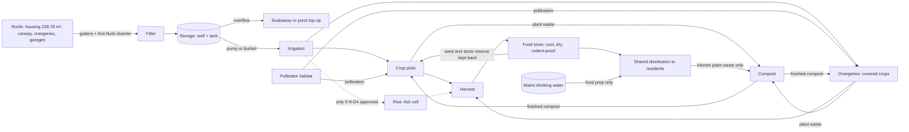

# Hive System concept plan

**MMUCO ORION HIVE SYSTEM — CONCEPT PROPOSAL — NOT ISSUED** (25 Oct 2026)

> **This is a written concept plan, not a design.** It is the first deliverable the brief asks for (`source_refs/hive_system_brief_2026-10-25.md`).
>
> - No geometry has been made and no frozen or issued drawing has been touched.
> - The Hive is a **design hypothesis to be tested**. Nothing here claims that the garden will feed its residents.
> - Values are classed as follows:
>   - **MEASURED:** taken by script from the Triplex backyard concept.
>   - **VERIFIED:** from the issued Draft 0.2.2.
>   - **PLACEHOLDER:** a modelling value chosen to make progress, with no evidence behind it.
>   - **ILLUSTRATIVE:** an example value, not site data.
>   - **UNKNOWN.**
> - Evidence: `evidence/hive_measure.mjs` and `evidence/hive_measure_output.json`. The areas are from 50 mm grid sampling, with a positive control, and are accurate to about ±0.5 m².

## 0. Where the Hive sits

The brief asks to keep three things distinct:

| Layer | What it is | Status |
|---|---|---|
| **1. Orion Duplex housing node** | Two mirrored single-storey dwellings with a footprint of 18,600 × 12,300 = 228.78 m² | VERIFIED as drawn; Draft 0.2.2 is frozen and **unchanged** |
| **2. The Hive garden** | The duplex's ecological food-production system: crop plots, water, pollinators, compost and food store | **This plan** (PROPOSED) |
| **3. Shared compound facilities** | From the Triplex concept: the shared walkway, canopy and covered patio, pond, fountain (optional), back gate and the animal facilities. **Access: residents and their households only** (Q-A, 25 Oct 2026); the Triplex records call it the "public" garden | Triplex proposal (PROPOSED) |

**Where the Hive's land comes from** (MEASURED):
- **255.4 m²** of uncommitted open ground in the Triplex public garden;
- the two orangeries, **80.0 m²** of covered growing space;
- **81.2 m²** of open private rear garden (2 × 40.6 m²).

**Who owns and accesses the Hive** is decision **H-D1** (section 6). The brief requires this to be confirmed, not assumed.

## 1. System diagram



**Rules the diagram encodes:**
- **Drinking water** comes from the mains and is separate. Rain, well, pond and fish water are **never** drinking water.
- **Compost** takes plant waste only.
- **A reserve is kept back** each cycle (seed, stock, water). That is the "hive" principle (section 3.1).

## 2. Land-use schedule

### 2.1 What exists in the Triplex concept (MEASURED from the drawing; sizes are Triplex PLACEHOLDERS)

| Area | m² | Use |
|---|---|---|
| Uncommitted open garden (public node) | **255.4** | Available to the Hive |
| Orangeries (2 × 8.0 × 5.0) | 80.0 | Covered food growing: part of the Hive |
| Shared walkway | 56.7 | Shared circulation |
| Covered patio under the canopy (off the walkway) | 25.0 | Shared gathering; rain catchment overhead |
| Pond (not a swimming pool) | 24.0 | Shared amenity and wildlife; **separate from any rice–fish cell** |
| Shed | 7.2 | Tools; a possible food store (H-D8) |
| Kennel and cat shelter | 5.4 | Animals; kept apart from food |
| Rainwater well | 1.8 | Storage (depth UNKNOWN) |
| Fountain (optional, D6) | 1.8 | Shared amenity |
| **Public node total** | **457.3** | Target 457.56 (2 × 228.78); the difference is grid sampling |
| Private rear garden A, open | 40.6 | Dwelling A (the conservatory takes 3.81) |
| Private rear garden B, open | 40.6 | Dwelling B |

### 2.2 Proposed Hive allocation of the 255.4 m² open garden (all PLACEHOLDERS, for decision)

| Hive group | Proposed m² | Where | Why there |
|---|---|---|---|
| **HV-01 Crop plots** (raised beds) | 90 | Sun zone around the orangeries, plus strips east and west of the garden core | The sunniest ground. The north end is furthest from the house's shadow, on the assumed north |
| **HV-04 Pollinator habitat** | 45 | 1 m wide strips along the east and west boundaries and beside the walkway | Flowering edges next to the crops, and nesting habitat away from the busiest paths |
| **HV-02 Rice–fish cell** (only if H-D4 is approved) | 12 reserved | A fenced, shallow cell near the orangeries, **separate from the pond and the well** | Trial size only. Left as planting until it is validated |
| **HV-05 Compost** | 6 | Beside the shed, on the service side | Kept away from the well (about 13 m in the drawing), the food store and the seating |
| **HV-03 Extra rain tank** | 4 reserved | Beside the canopy and well | The well alone is too small (section 4) |
| **HV-06 Maintenance paths** (0.9 m) | inside the above | Between beds | Access for wheelbarrows and hoses |
| **Unallocated** (seating, lawn, buffers) | 98.4 | Garden core | Rest, play and flexibility |
| **Total** | **255.4** | | |

**Private rear gardens:** up to half of each (about 20 m² per dwelling) could hold that household's own beds. The proposed H-D1 policy (section 6.1) covers only the community Hive, so whether private beds count as part of the Hive is an open question (Q-B).

**Arithmetic only, not a yield claim:**
- The productive land (open garden 255.4 + orangeries 80.0 + private gardens 81.2) is **416.6 m²**.
- At the placeholder occupancy of 8 residents (PA-13: 2 bed / 4 person × 2), that is **about 52 m² per resident**.
- Whether that is enough for anything depends on yields, which have **not** been calculated (section 3.2).

## 3. Crops and seasons

### 3.1 The "hive" principle (from the user's notes)

A honeybee colony produces in season, stores a surplus for the lean season, and never takes the colony's own reserve. Applied to the garden, as **design principles to test**:
1. **Produce in cycles:** sequence the crops so that something is always growing.
2. **Store the surplus:** a food store for the gap between harvests.
3. **Keep the reserve back:** seed, seed potatoes, compost and a water reserve are never consumed.
4. **Diversity over monoculture:** several crops and companions, so that one failure doesn't empty the store.
5. **Share at colony level:** a fair, recorded distribution.

### 3.2 Preliminary crop-and-season table

This assumes a temperate (UK-type) climate. The site's climate, soil and frost dates are **UNKNOWN** and must be confirmed. **No yields are given; they must be measured** (section 3.3).

| Crop | Outdoors here? | Sow or plant | Harvest | Pollinators needed? | Rotation family | Notes |
|---|---|---|---|---|---|---|
| **Potatoes** | Yes | Plant Mar–May | Earlies Jun–Jul; maincrop Aug–Oct | No (tubers) | Nightshade | Late blight in wet summers. Store cool and dark. Keep seed potatoes back |
| **Broad beans** | Yes | Oct–Nov or Feb–Apr | May–Jul | Benefit from bees | Legume (fixes nitrogen) | Hardy; an early-season crop |
| **Runner and French beans** | Yes, after frost | May–Jun | Jul–Oct | Runner beans especially benefit from bees | Legume | Need supports; can be dried for storage |
| **Rice** | **Not a usual outdoor crop here** | Trial only | — | Wind-pollinated | Grass | Needs warmth and flooded or saturated soil. **Experimental**, in an orangery or the HV-02 trial cell |
| **Yam** (*Dioscorea*) | **No:** needs a long, warm, frost-free season | Trial only, under glass | — | — | — | **Experimental** in an orangery. Temperate root crops (for example oca or Jerusalem artichoke) could be listed as alternatives (H-D3) |
| Pollinator plants (native wildflowers and herbs) | Yes | Autumn or spring | Flowering Mar–Oct, staggered | — | — | Continuous bloom supports bees through the season |

**The orangeries:** use them for season extension and warm crops, including the rice and yam trials. Check them for overheating in summer (shading and ventilation).

### 3.3 What to measure, so the hypothesis becomes data

- **Harvest log:** kg per plot per crop per season. This gives yield per m².
- **Rainfall:** an on-site rain gauge.
- **Water use:** a tank level or meter reading for irrigation.
- **Labour:** hours per week, by task.
- **Pollinators:** simple monthly counts along a fixed route.
- **Soil:** a test before planting (pH, nutrients, any contamination).

## 4. Water: demand and rainwater harvesting

**Supply.** The catchment is the horizontal projection, so the plan area is right whatever form the roof takes. The runoff coefficient (0.8) and filter efficiency (0.9) are **PLACEHOLDERS**.

| Catchment | m² | m³ per 100 mm of rain |
|---|---|---|
| Housing roof | 228.78 (VERIFIED plan area) | 16.47 |
| Canopy | 48 (PLACEHOLDER) | 3.46 |
| Orangeries | 80 (PLACEHOLDER) | 5.76 |
| Garages | 43.52 (PLACEHOLDER) | 3.13 |
| **Total** | **400.30** | **28.82** |

**Annual yield** at 600 / 800 / 1,000 mm of rain: **173 / 231 / 288 m³**. These rainfall figures are **ILLUSTRATIVE**; the site's rainfall is UNKNOWN.

**Storage is the bottleneck.**
- The well (Ø 1.5) holds only **1.77 m³ per metre of depth**, and its depth is UNKNOWN.
- So a 2 m deep well holds about 3.5 m³, while a single 100 mm wet month yields about 29 m³.
- Without extra tanks (HV-03), most of the water overflows. Tank size should follow the dry-season irrigation demand.

**Demand: UNKNOWN until calculated.** The method:
1. Find the water need for each crop (mm per week, in season).
2. Multiply by the plot area.
3. Subtract the expected rainfall in that period.
4. The result is the irrigation need. Compare it with the stored volume and the expected dry spells.

The rice–fish cell (if approved) would also need water to keep it flooded, and to make up for evaporation.

**Quality and separation:**
- **First-flush diverters** on the downpipes.
- **Filters** before storage.
- **Covered tanks**, kept dark.
- **Overflow** to a soakaway or pond.
- **Not drinking water.**

Edible crops can be irrigated with harvested rainwater. Water from the pond or a fish cell should not be put on leafy crops eaten raw. Stored water and anything that sprays (the fountain, sprinklers) need a **Legionella risk assessment**; as a landlord, the owner has a duty to assess this.

**Moving the water:**
- **Rope and bucket** (the transcript): possible, but labour-heavy.
- **A pump:** needs power. The D20 generator's fuel must be kept away from the water and the crops.

## 5. Risks

| Type | Risk | Mitigation to consider |
|---|---|---|
| Ecological | Monoculture failure; pests and disease (for example potato blight) | Rotation, diversity, resistant varieties, the reserve store |
| Ecological | Invasive or escaped species (plants, fish) | Native planting; **never release fish into the wild**; check the rules on keeping the chosen fish species |
| Ecological | Pesticides harming pollinators | Pesticide-conscious management (the brief): avoid spraying, especially on flowering plants |
| Animal welfare | Fish: water quality, temperature, oxygen, predators, winter survival | Only after H-D4 assessment; a specialist species choice; welfare standards |
| Animal welfare | Dog and cat near bees and fish; animals in food plots | Fencing; the kennel kept apart (Triplex rule) |
| Human safety | **Drowning:** well, pond, rice–fish cell (children) | Covers and fences (Triplex rules: the well is covered, the pond has edge protection) |
| Human safety | Bee stings and allergies (anaphylaxis) near paths and play | **No managed hive unless approved (H-D5)**; habitat strips away from the seating |
| Food safety | Roof runoff contamination (bird droppings, roof materials) | First-flush diverter; filter; a roofing-material check |
| Food safety | Compost pathogens; dog or human waste; rodents | **Plant waste only**; hot composting; rodent-proof bins; never pet waste |
| Food safety | Fish or pond water on raw-eaten crops | Keep the water sources separate (section 4) |
| Food safety | Legionella in warm stored water or sprays | Risk assessment; covered, cool tanks; no stagnant spray features |
| Food safety | Diesel or fuel spill (D20 generator) | Bunded fuel storage, away from water and crops |
| Public health | Mosquitoes breeding in standing water | Covered tanks; moving water; fish (if any) eat larvae |
| Maintenance | Labour: who weeds, waters, harvests and composts | A rota and named responsibility (H-D9) |
| Maintenance | Theft or unfair sharing of produce | A recorded, transparent distribution (H-D1, H-D10) |
| Water | Dry spells exhaust the small storage | Tank sizing (HV-03); mulching; drought-tolerant crops |

## 6. Assumptions, missing data and decisions

**Assumptions** (labelled; change them freely):
- The site is temperate (UK-type). This is not confirmed.
- North is ASSUMED (PA-07).
- Residents: 8 (PA-13).
- The Triplex backyard layout and its placeholder sizes stand as drawn.
- The housing is unchanged. D21 (basement) is a separate proposal and does not affect the Hive.

**Missing site data:**
- the site boundary and survey;
- true north and orientation;
- climate (frost dates, rainfall);
- soil type, pH and contamination;
- groundwater;
- whether there's a mains water connection for the garden;
- roofing material;
- the labour available;
- the household food demand.

**Decisions requiring approval:**

| ID | Decision | Default proposed here |
|---|---|---|
| **H-D1** | Ownership, access and boundary of the Hive | **PROPOSED — FOR REVIEW (25 Oct 2026):** "Community Hive with protected ecological access". The landowner keeps legal title; residents take part under published, lawful access rules; essential food needs come first, with transparent surplus distribution. Full text in section 6.1. **Not approved.** This replaces the earlier "mixed" default. **Q-A answered:** the shared garden is residents-only, so the Hive sits inside it with no separate boundary |
| **H-D2** | Who the Hive feeds: the duplex residents only, or the wider compound or community | Duplex residents (8, PA-13) |
| **H-D3** | Crop list for the actual site | Potatoes and beans outdoors; rice and yam as **orangery trials only**; temperate alternatives listed |
| **H-D4** | Rice–fish subsystem | **Investigate only.** 12 m² reserved as planting until water, fish species, welfare and suitability are assessed |
| **H-D5** | Managed beehive | **Not modelled.** A pollinator habitat zone only (brief §4) |
| **H-D6** | Compost scope | Plant waste only |
| **H-D7** | Water storage | Add tanks (HV-03), sized from the irrigation demand |
| **H-D8** | Food store | In the shed if it can be kept cool, dry and rodent-proof; otherwise a separate store |
| **H-D9** | Management and labour | A rota with named responsibility |
| **H-D10** | Allocation and distribution rules | **Open to all residents on the same terms.** No criteria based on ethnicity or any other protected characteristic (Equality Act 2010) |

### 6.1 H-D1: ownership, access and harvest governance (PROPOSED — FOR REVIEW; not approved)

**Source:** the user's policy text of 25 Oct 2026, kept unchanged in `source_refs/hd1_governance_policy_PROPOSED_2026-10-25.md`. **Scope:** written policy only; no geometry is authorised.

| Part | Proposed policy (summary) |
|---|---|
| **H-D1.1 Ownership** | A community-managed Hive. **The landowner keeps legal title.** Residents take part under a written governance and access agreement. That does not by itself transfer ownership, create a tenancy or set up a legal entity. Any trust, cooperative or lease must be considered and approved separately |
| **H-D1.2 Access** | Residents and their authorised household members, under published rules on safety, maintenance, ecological protection and responsible use. **The rules are applied consistently and lawfully; restrictions must rest on legitimate needs, not discriminatory criteria** (consistent with H-D10). The Hive stays **distinct from any wider public garden or public-access area** unless a separate access decision is made |
| **H-D1.3 Harvest** | A shared-allocation model: (1) essential needs first, under a transparent, consistently applied policy; (2) shared production; (3) a recorded, rule-based surplus distribution; (4) a reserve kept back for future cycles; (5) traceability of harvests, distribution, losses and reserves; (6) food safety. **No yield or self-sufficiency is claimed** |
| **H-D1.4 Governance** | A written agreement before implementation, covering responsibilities, access and safety, allocation, water and ecology, records, complaints and disputes, costs and authority, and review and termination. It must be checked against the applicable law before it is relied on |
| **H-D1.6 Scope** | Frozen and issued files preserved; no 3D geometry; changes kept inside this workspace; recorded as PROPOSED — FOR REVIEW |

**How it fits the rest of this plan:**
- **It agrees with H-D2** (feeds the residents), **H-D9** (named management) and **H-D10** (non-discriminatory allocation). It fills in **H-D8** (store) and section 3.3 (measurement) through its traceability rule.
- **Layout conflict resolved (Q-A answered by the user, 25 Oct 2026).** The Triplex shared garden (the "public node") is **residents-only**: tenants and their households. So it is not a public-access area in the sense of H-D1.2.
  - **The Hive can sit inside the shared garden, as in section 2.2, without a separate boundary.**
  - The H-D1.2 safety restrictions still apply *inside* it: the covered well, pond edge protection, the fenced rice–fish cell (if approved), and compost bins. These are local guards, not a Hive perimeter.
  - The back gate's "secure, controlled access" is consistent with this.

**Open questions.** H-D1 stays open until the project owner answers these:

| # | Question | Source |
|---|---|---|
| 1 | Who is the legal landowner? | H-D1.5 |
| 2 | Who will coordinate day-to-day management? | H-D1.5 |
| 3 | How will essential food needs and allocation priorities be assessed? | H-D1.5 |
| 4 | How will residents take part in governance? | H-D1.5 |
| 5 | What legal form, if any, should the management agreement take? | H-D1.5 |
| **Q-A** | Is the Triplex "public garden" open to the public, or residents only? | **ANSWERED (user, 25 Oct 2026): residents-only** (tenants and their households). The Hive sits inside it with no separate boundary |
| **Q-B** | Are beds in the private rear gardens part of the community Hive, or private and outside H-D1? | This plan |

**Orangeries, confirmed by the user (25 Oct 2026): keep them at 90 degrees to each other.** They stay at +45° and −45° to the X axis (the Triplex D5 default), so they are perpendicular to each other. `hive.dxf` is unchanged, and its validator now checks this.

**Links to the Triplex decisions:**
- **D2:** the Hive sits inside the 457.56 m² public node.
- **D3, D5–D7:** the orangeries are part of the Hive.
- **D14:** sunlight drives the crop placement.
- **D15:** orientation indicators.
- **D17 and D18:** cooking and fire, if approved, need separation from the crops and the compost.
- **D20:** generator fuel kept away from the water and the crops.

## 7. Proposed layout (schematic, not to scale; north ASSUMED up)

The duplex footprint is unchanged. Shared facilities and dwelling-associated areas are kept distinct.

```
                               BACK GATE
  +---------------------------------+==+---------------------------------+  far boundary
  | P   /ORANGERY A\    HV-01 beds  |  |  HV-01 beds    /ORANGERY B\   P |
  | P   \  (+45°)  /                |W |                \  (-45°)  /   P |  SUN ZONE
  | P     HV-01 beds   [HV-02 rice- |A |  HV-01 beds                  P |  (Hive crops)
  | P                  fish cell?]  |L |                ~~ POND ~~    P |
  | P   kennel/cat     (fountain)   |K |                ~~~~~~~~~~    P |  GARDEN CORE
  | P   HV-05 compost  +---------- CANOPY / covered patio -----+      P |
  | P   SHED (HV-07?)  |   shared walkway (Y-shape)        [HV-03 tank] (WELL) |  SHADE BAND
  +--------------------+--gate A-----------------------gate B----+--------+  private/public line
  | PRIVATE REAR GARDEN A          |  PRIVATE REAR GARDEN B                |  dwelling-associated
  | (optional private Hive beds)   |  (optional private Hive beds)         |  (H-D1)
  +--------------------------------+---------------------------------------+  rear wall
                     ORION DUPLEX (Draft 0.2.2, unchanged)
  P = HV-04 pollinator habitat strip (1 m)   W = walkway spine
```

**Model groups for later (brief §5).** These are not built yet. Each stays identifiable as a proposed addition:

| Group | Contents |
|---|---|
| `01_HOUSING_ORION_DUPLEX` | Unchanged |
| `HV-01_CROP_PLOTS` | Crop beds |
| `HV-02_RICE_FISH_PROPOSED` | Only if H-D4 is approved |
| `HV-03_RAINWATER_IRRIGATION` | Gutters, filter, tanks, well link, irrigation |
| `HV-04_POLLINATOR_HABITAT` | Habitat strips |
| `HV-05_COMPOST` | Compost bays |
| `HV-06_PATHS_MAINTENANCE` | Maintenance paths |
| `HV-07_FOOD_STORE` | Food store |
| Triplex shared groups | `02`/`03`/`05`/`06`/`09`/`11`/`12`: garden, walkway, canopy, well, pond, boundary, fountain |

## 8. Science note: bees and wasps (evidence-based)

- **Bees evolved from wasps, not the other way round.** Bees descend from predatory wasp ancestors (the apoid wasps) that switched from hunting insects to collecting pollen and nectar more than 100 million years ago, as flowering plants spread.
- **In evolutionary terms, bees are a specialised branch inside the wasp lineage.** Both belong to the order Hymenoptera. In everyday and ecological terms they are different groups with different roles.
- **Wasps did not arise from bees through food shortage.** Neither group came from fungi or from carnivorous plants; fungi are a separate kingdom. Any resemblance between flowers, flytraps and insects is not common descent.
- **Many wasps are useful in a food garden:** they control pests, and some pollinate. The design aim is to support pollinators and other beneficial insects, not to eliminate wasps.

## 9. Next steps (not started)

1. **Approve or amend H-D1 to H-D10**, especially H-D1 (who owns the Hive and who can use it).
2. **Gather the missing site data** in section 6, starting with the climate, soil and true north.
3. **Then a 2D Hive layout DXF**, built on the Triplex backyard concept, in this workspace.
4. **3D only after:**
   - a new session in `u\` confirms the SolidCraft tools (Stage 0 of the Triplex plan);
   - the protected-file checks pass.
